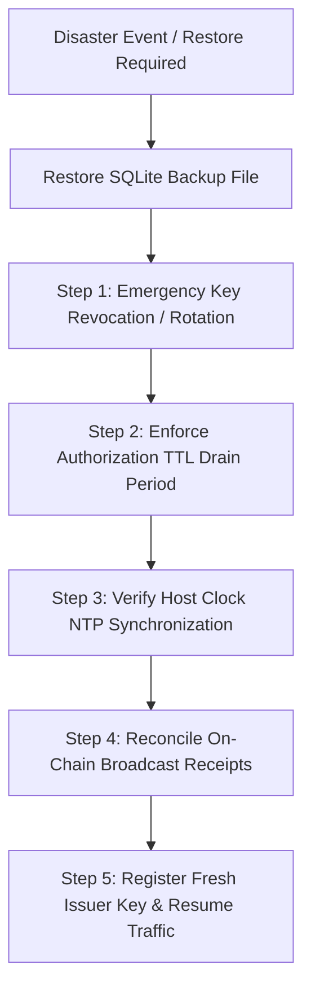

# Web3User Permission Lab — Operations, Backup Consistency & Disaster Recovery Guide

## 1. Scope and Architectural Boundaries

Web3User Permission Lab is a development-stage off-chain transaction authorization and policy governance engine. It utilizes an embedded SQLite database in Write-Ahead Logging (WAL) mode for persistent single-use replay protection, policy revision tracking, cryptographic key registry, and stateful cumulative spending budget enforcement.

### 1.1 Local Block Storage Requirement (No Network Filesystems)
- **Local Storage Only**: The SQLite database (`.sqlite`, `.sqlite-wal`, `.sqlite-shm`) must reside on directly attached, high-performance local block storage (such as NVMe SSDs or dedicated cloud block storage like AWS EBS or GCP Persistent Disk mounted locally with standard journaling filesystems like ext4, XFS, or NTFS).
- **Network Filesystems Strictly Prohibited**: Network-mounted filesystems—including **NFS, SMB/CIFS, AWS EFS, Azure Files, and GlusterFS**—are strictly unsupported. Network storage protocols frequently implement non-compliant or high-latency POSIX advisory byte-range file locking and lack coherent shared memory across nodes, creating severe hazards of database corruption, deadlock, and silent lost updates under multi-process concurrency.

### 1.2 Single-Host Operational Boundary (No Multi-Host Clustering)
- **Single-Host Concurrency**: Concurrency governance, write transaction serialization (`BEGIN IMMEDIATE;`), and contention retry backoff are designed exclusively for multiple worker processes running on the **same operating system host** sharing a common local database file.
- **No Multi-Host Clustering**: Web3User does **not** implement distributed consensus (such as Raft or Paxos) across independent network nodes. Deploying multiple hosts where each host connects to an independent local SQLite database creates disjoint replay state: an authorization consumed on Host A cannot be tracked by Host B, permitting duplicate transaction approvals.
- **Relayer Routing**: When scaling relayers across multiple worker hosts, architecture designs must ensure that requests for a given authorization identity or policy are pinned to a single authoritative engine instance, or rely on downstream on-chain nonces for network-wide deduplication.

---

## 2. Backup Consistency & Snapshot Procedures

SQLite Write-Ahead Logging (WAL) mode alters how transactions are committed to disk. Committed transactions write pages to the `-wal` file; the primary `.sqlite` file is updated only during WAL checkpoints.

### 2.1 The Inconsistent Backup Hazard
Taking a cold copy of `web3user.sqlite` while worker processes are actively writing or without flushing WAL frames will result in an inconsistent or incomplete backup:
- Transactions committed in the `-wal` file may be omitted from the backup copy.
- Copying `.sqlite` and `.sqlite-wal` at different instants while concurrent writes occur can create mismatched log frames, causing database corruption (`SQLITE_CORRUPT`) upon restore.

### 2.2 Recommended Backup Procedures

#### Procedure A: Coordinated Truncate Checkpoint (Online Backup)
1. Invoke the engine's storage checkpoint API in `TRUNCATE` mode during a low-traffic maintenance window:
   ```typescript
   const result = engine.storage.checkpoint("TRUNCATE");
   if (result.busy) {
     console.warn("Checkpoint encountered active readers; frames remain in WAL.");
   }
   ```
2. Verify that all log frames were checkpointed (`logFrames === 0` and `checkpointedFrames === 0`).
3. Safely capture the primary `.sqlite` file.

#### Procedure B: Clean Cold Backup (Process Stopped)
1. Gracefully terminate all worker processes accessing the database (`engine.close()`).
2. Verify that SQLite automatically merged and removed the `-wal` and `-shm` files.
3. Archive the `.sqlite` file using filesystem snapshot tools.

#### Procedure C: SQLite Online Backup API / VACUUM INTO
Utilize SQLite's atomic online backup mechanism or SQL command:
```sql
VACUUM INTO '/path/to/backup/web3user-backup.sqlite';
```
This guarantees a fully consistent, single-file snapshot without interrupting live readers or writers.

---

## 3. Restoration Risks & Threat Vectors (SEC-10-01)

Restoring an earlier database snapshot rewinds persistent state. Because Web3User relies on persistent SQLite records for replay prevention and cumulative budget enforcement, snapshot restorations introduce specific security risks:

### 3.1 Authorization Replay Hazard
- **Threat Scenario**:
  1. At time $T_0$, authorization `auth_1` is issued (`state = 'issued'`). A database backup is taken.
  2. At time $T_1$, `auth_1` is consumed (`state = 'consumed'`), and the relayer broadcasts the transaction to Ethereum.
  3. At time $T_2$, a system fault occurs. The operator restores the database from the $T_0$ backup.
  4. In the restored database, `auth_1` has reverted to `state = 'issued'`.
  5. If $T_2$ is still within the authorization's validity window ($T_2 < \text{expiresAtSeconds}$) and within the startup forward gap ($T_2 - T_0 \le 3600\text{s}$), a second consumption request for `auth_1` will return `ALLOW`.
- **Impact**: Off-chain replay of previously authorized transactions. If the downstream wallet or contract does not enforce on-chain nonces, the transaction may be executed twice on the blockchain.

### 3.2 Cumulative Budget Rewind Hazard
- **Threat Scenario**:
  1. A policy configures an hourly spending budget of 100 tokens. A backup is taken at $T_0$ with 0 spent.
  2. At $T_1$, transactions totaling 90 tokens are consumed.
  3. At $T_2$, a transaction for 20 tokens is rejected with `DENY` (budget exceeded: $90 + 20 = 110 > 100$).
  4. The database is restored to the $T_0$ backup.
  5. In the restored database, recorded spend is rewound to 0 tokens.
  6. Subsequent transactions up to 100 tokens will be approved within the same UTC hour.
- **Impact**: Cumulative spending limits are bypassed across the incident window, allowing total approved spending to exceed the policy's configured cap.

### 3.3 Clock Drift & Startup Forward Gap Protection
- `ClockGuard` enforces a startup damage-containment threshold (`MAX_STARTUP_FORWARD_GAP_SECONDS = 3600` / 1 hour):
  $$\text{startupGap} = \text{currentWallClockSeconds} - \text{persistedHighWaterSeconds}$$
- If a restored backup was taken more than 1 hour prior to current host wall time, the store will fail closed immediately during initialization:
  ```text
  Error: Store startup rejected: forward clock gap of X seconds exceeds maximum allowed startup threshold (3600s).
  ```
- **Operator Implication**: Restoring long-term backups requires explicit operational handling (overriding `maxStartupForwardGapSeconds`) after verifying clock alignment and completing the safe recovery procedures below.

---

## 4. Safe Disaster Recovery Runbook

When a disaster recovery event requires restoring a database from backup, operators **MUST** follow this sequence to prevent authorization replay and budget overruns:



### Step 1: Emergency Key Revocation / Rotation
1. Immediately upon opening the restored database (before enabling public ingestion), revoke all issuer keys that were active during the gap between the backup timestamp and the current time:
   ```typescript
   engine.keys.revoke("active-issuer-key-id");
   ```
2. **Security Guarantee**: Because `consumeSignedTransactionAuthorizationV3` strictly checks `keyRow.status !== 'revoked'`, revoking the issuer key permanently invalidates **all** authorizations signed by that key. Any restored `issued` authorization presented by an attacker will immediately fail closed with:
   `"Issuer key has been revoked."`

### Step 2: Enforce Authorization TTL Drain Period
1. Maintain authorization endpoints in maintenance mode for at least the maximum configured authorization TTL (default: 300 seconds / 5 minutes).
2. **Security Guarantee**: All unexpired authorizations issued prior to the incident will naturally cross their signed `expiresAtSeconds` threshold. Once expired, consumption is permanently rejected regardless of database state.

### Step 3: Verify Host Clock NTP Synchronization
1. Verify that the host operating system is actively synchronized via NTP:
   ```bash
   chronyc tracking   # or: timedatectl status
   ```
2. Ensure clock offset is within acceptable bounds (< 100ms) before restarting application workers.

### Step 4: Reconcile On-Chain Broadcast Receipts
1. Query downstream Ethereum RPC nodes or block explorer APIs for transactions broadcast by relayers during the incident window.
2. Identify which authorizations were executed on-chain.
3. In the restored database, manually mark those authorization IDs as consumed or adjust the policy budget accumulator spend to reflect real on-chain expenditures.

### Step 5: Register Fresh Issuer Key & Resume Traffic
1. Generate and register a brand new active Ed25519 issuer keypair:
   ```typescript
   const { keyId, privateKey } = engine.keys.generate();
   // Register key with validFromSeconds = currentNowSeconds
   ```
2. Re-enable relayer traffic.

---

## 5. Fundamental Limitation: The External Monotonicity Requirement

> [!IMPORTANT]
> **Defending Against Whole-System Rollback Requires External Monotonicity**
> An embedded local database (such as SQLite) running on a single host **cannot** theoretically detect or prevent rollback of its own underlying storage volume if the entire disk image or virtual machine snapshot is rewound by an operator or infrastructure provider.
>
> If absolute protection against local snapshot rollback is mandatory in your threat model, the authorization system **must** be coupled with an **external, durable monotonic sequence source**:
> - **On-Chain EVM Nonces**: The Ethereum blockchain enforces monotonic account nonces. Even if an off-chain authorization engine is rewound to an earlier state, an EVM transaction signed with a previously mined nonce will be rejected by blockchain consensus.
> - **External Epoch / Monotonic Counter Service**: A distributed consensus cluster (e.g. Raft, Apache ZooKeeper, Google Cloud Spanner) or hardware security module (HSM) with monotonic hardware counters can act as an external sequence witness that cannot be rewound by local disk snapshot restores.

Web3User Permission Lab is an off-chain decision engine prototype and does not provide built-in distributed consensus. Production integrations must rely on downstream blockchain nonces or external consensus witnesses to achieve whole-system rollback resilience.
