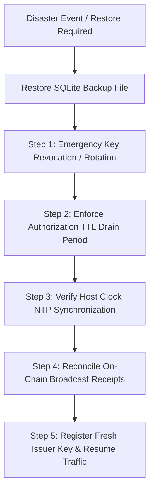

# Web3User Permission Lab — Operations, Backup Consistency & Disaster Recovery Guide

## 1. Scope and Architectural Boundaries

Web3User Permission Lab is a development-stage off-chain transaction authorization and policy governance engine. It utilizes an embedded SQLite database in Write-Ahead Logging (WAL) mode for persistent single-use replay protection, policy revision tracking, cryptographic key registry, and stateful cumulative spending budget enforcement.

### 1.1 Local Block Storage Requirement (No Network Filesystems)
- **Local Storage Only**: The SQLite database (`.sqlite`, `.sqlite-wal`, `.sqlite-shm`) must reside on directly attached, high-performance local block storage (such as NVMe SSDs or dedicated cloud block storage like AWS EBS or GCP Persistent Disk mounted locally with standard journaling filesystems like ext4, XFS, or NTFS).
- **Network Filesystems Strictly Prohibited**: Network-mounted filesystems—including **NFS, SMB/CIFS, AWS EFS, Azure Files, and GlusterFS**—are strictly unsupported. Network storage protocols frequently implement non-compliant or high-latency POSIX advisory byte-range file locking and lack coherent shared memory across nodes, creating severe hazards of database corruption, deadlock, and silent lost updates under multi-process concurrency.

### 1.2 Single-Host Operational Boundary (No Multi-Host Clustering)
- **Single-Host Concurrency**: Concurrency governance, write transaction serialization (`BEGIN IMMEDIATE;`), and contention retry backoff are designed exclusively for multiple worker processes running on the **same operating system host** sharing a common local database file.
- **No Multi-Host Clustering**: Web3User does **not** implement distributed consensus (such as Raft or Paxos) across independent network nodes. Deploying multiple hosts where each host connects to an independent local SQLite database creates disjoint replay state: an authorization consumed on Host A cannot be tracked by Host B, permitting duplicate transaction approvals.
- **Relayer Routing**: When scaling relayers across multiple worker hosts, architecture designs must ensure that requests for a given authorization identity or policy are pinned to a single authoritative engine instance, or rely on downstream on-chain nonces for network-wide deduplication.

---

## 2. Backup Consistency & Snapshot Procedures

SQLite Write-Ahead Logging (WAL) mode alters how transactions are committed to disk. Committed transactions write pages to the `-wal` file; the primary `.sqlite` file is updated only during WAL checkpoints.

### 2.1 The Inconsistent Backup Hazard
Taking a cold copy of `web3user.sqlite` while worker processes are actively writing or without flushing WAL frames will result in an inconsistent or incomplete backup:
- Transactions committed in the `-wal` file may be omitted from the backup copy.
- Copying `.sqlite` and `.sqlite-wal` at different instants while concurrent writes occur can create mismatched log frames, causing database corruption (`SQLITE_CORRUPT`) upon restore.

### 2.2 Recommended Backup Procedures

#### Procedure A: Coordinated Truncate Checkpoint (Online Backup)
1. Invoke the engine's storage checkpoint API in `TRUNCATE` mode during a low-traffic maintenance window:
   ```typescript
   const result = engine.storage.checkpoint("TRUNCATE");
   if (result.busy) {
     console.warn("Checkpoint encountered active readers; frames remain in WAL.");
   }
   ```
2. Verify that all log frames were checkpointed (`logFrames === 0` and `checkpointedFrames === 0`).
3. Safely capture the primary `.sqlite` file.

#### Procedure B: Clean Cold Backup (Process Stopped)
1. Gracefully terminate all worker processes accessing the database (`engine.close()`).
2. Verify that SQLite automatically merged and removed the `-wal` and `-shm` files.
3. Archive the `.sqlite` file using filesystem snapshot tools.

#### Procedure C: SQLite Online Backup API / VACUUM INTO
Utilize SQLite's atomic online backup mechanism or SQL command:
```sql
VACUUM INTO '/path/to/backup/web3user-backup.sqlite';
```
This guarantees a fully consistent, single-file snapshot without interrupting live readers or writers.

---

## 3. Restoration Risks & Threat Vectors (SEC-10-01)

Restoring an earlier database snapshot rewinds persistent state. Because Web3User relies on persistent SQLite records for replay prevention and cumulative budget enforcement, snapshot restorations introduce specific security risks:

### 3.1 Authorization Replay Hazard
- **Threat Scenario**:
  1. At time $T_0$, authorization `auth_1` is issued (`state = 'issued'`). A database backup is taken.
  2. At time $T_1$, `auth_1` is consumed (`state = 'consumed'`), and the relayer broadcasts the transaction to Ethereum.
  3. At time $T_2$, a system fault occurs. The operator restores the database from the $T_0$ backup.
  4. In the restored database, `auth_1` has reverted to `state = 'issued'`.
  5. If $T_2$ is still within the authorization's validity window ($T_2 < \text{expiresAtSeconds}$) and within the startup forward gap ($T_2 - T_0 \le 3600\text{s}$), a second consumption request for `auth_1` will return `ALLOW`.
- **Impact**: Off-chain replay of previously authorized transactions. If the downstream wallet or contract does not enforce on-chain nonces, the transaction may be executed twice on the blockchain.

### 3.2 Cumulative Budget Rewind Hazard
- **Threat Scenario**:
  1. A policy configures an hourly spending budget of 100 tokens. A backup is taken at $T_0$ with 0 spent.
  2. At $T_1$, transactions totaling 90 tokens are consumed.
  3. At $T_2$, a transaction for 20 tokens is rejected with `DENY` (budget exceeded: $90 + 20 = 110 > 100$).
  4. The database is restored to the $T_0$ backup.
  5. In the restored database, recorded spend is rewound to 0 tokens.
  6. Subsequent transactions up to 100 tokens will be approved within the same UTC hour.
- **Impact**: Cumulative spending limits are bypassed across the incident window, allowing total approved spending to exceed the policy's configured cap.

### 3.3 Clock Drift & Startup Forward Gap Protection
- `ClockGuard` enforces a startup damage-containment threshold (`MAX_STARTUP_FORWARD_GAP_SECONDS = 3600` / 1 hour):
  $$\text{startupGap} = \text{currentWallClockSeconds} - \text{persistedHighWaterSeconds}$$
- If a restored backup was taken more than 1 hour prior to current host wall time, the store will fail closed immediately during initialization:
  ```text
  Error: Store startup rejected: forward clock gap of X seconds exceeds maximum allowed startup threshold (3600s).
  ```
- **Operator Implication**: Restoring long-term backups requires explicit operational handling (overriding `maxStartupForwardGapSeconds`) after verifying clock alignment and completing the safe recovery procedures below.

---

## 4. Safe Disaster Recovery Runbook

When a disaster recovery event requires restoring a database from backup, operators **MUST** follow this sequence to prevent authorization replay and budget overruns:



### Step 1: Emergency Key Revocation / Rotation
1. Immediately upon opening the restored database (before enabling public ingestion), revoke all issuer keys that were active during the gap between the backup timestamp and the current time:
   ```typescript
   engine.keys.revoke("active-issuer-key-id");
   ```
2. **Security Guarantee**: Because `consumeSignedTransactionAuthorizationV3` strictly checks `keyRow.status !== 'revoked'`, revoking the issuer key permanently invalidates **all** authorizations signed by that key. Any restored `issued` authorization presented by an attacker will immediately fail closed with:
   `"Issuer key has been revoked."`

### Step 2: Enforce Authorization TTL Drain Period
1. Maintain authorization endpoints in maintenance mode for at least the maximum configured authorization TTL (default: 300 seconds / 5 minutes).
2. **Security Guarantee**: All unexpired authorizations issued prior to the incident will naturally cross their signed `expiresAtSeconds` threshold. Once expired, consumption is permanently rejected regardless of database state.

### Step 3: Verify Host Clock NTP Synchronization
1. Verify that the host operating system is actively synchronized via NTP:
   ```bash
   chronyc tracking   # or: timedatectl status
   ```
2. Ensure clock offset is within acceptable bounds (< 100ms) before restarting application workers.

### Step 4: Reconcile On-Chain Broadcast Receipts
1. Query downstream Ethereum RPC nodes or block explorer APIs for transactions broadcast by relayers during the incident window.
2. Identify which authorizations were executed on-chain.
3. In the restored database, manually mark those authorization IDs as consumed or adjust the policy budget accumulator spend to reflect real on-chain expenditures.

### Step 5: Register Fresh Issuer Key & Resume Traffic
1. Generate and register a brand new active Ed25519 issuer keypair:
   ```typescript
   const { keyId, privateKey } = engine.keys.generate();
   // Register key with validFromSeconds = currentNowSeconds
   ```
2. Re-enable relayer traffic.

---

## 5. Fundamental Limitation: The External Monotonicity Requirement

> [!IMPORTANT]
> **Defending Against Whole-System Rollback Requires External Monotonicity**
> An embedded local database (such as SQLite) running on a single host **cannot** theoretically detect or prevent rollback of its own underlying storage volume if the entire disk image or virtual machine snapshot is rewound by an operator or infrastructure provider.
>
> If absolute protection against local snapshot rollback is mandatory in your threat model, the authorization system **must** be coupled with an **external, durable monotonic sequence source**:
> - **On-Chain EVM Nonces**: The Ethereum blockchain enforces monotonic account nonces. Even if an off-chain authorization engine is rewound to an earlier state, an EVM transaction signed with a previously mined nonce will be rejected by blockchain consensus.
> - **External Epoch / Monotonic Counter Service**: A distributed consensus cluster (e.g. Raft, Apache ZooKeeper, Google Cloud Spanner) or hardware security module (HSM) with monotonic hardware counters can act as an external sequence witness that cannot be rewound by local disk snapshot restores.

Web3User Permission Lab is an off-chain decision engine prototype and does not provide built-in distributed consensus. Production integrations must rely on downstream blockchain nonces or external consensus witnesses to achieve whole-system rollback resilience.


---

## 6. Cloud KMS Witness Operations & Key Lifecycle Runbooks

### 6.1 AWS KMS Manual Key Resource Rotation Runbook
AWS KMS does **not** support automatic or on-demand rotation for asymmetric keys. Rotation is performed via manual resource provisioning:

#### Step 1: Provision New Key Resource
```bash
aws kms create-key \
  --key-spec ECC_NIST_EDWARDS25519 \
  --key-usage SIGN_VERIFY \
  --description "Web3User Monotonic Witness Production Signing Key (Key Resource B)"
```
Note the newly generated Key ARN (`arn:aws:kms:<region>:<account>:key/<new-key-id>`).

#### Step 2: Extract Public Key & SHA-256 Fingerprint
```bash
aws kms get-public-key --key-id <new-key-arn> --output text --query PublicKey | base64 -d > new_pub.der

# Extract canonical SHA-256 fingerprint via self-contained Node.js command:
# (Hashes strictly the 32-byte raw public key point der[12..44] per canonical definition):
node -e '
const fs = require("node:fs");
const crypto = require("node:crypto");
const der = fs.readFileSync("new_pub.der");
const prefix = Buffer.from("302a300506032b6570032100", "hex");
if (der.length !== 44 || !der.subarray(0, 12).equals(prefix)) throw new Error("Invalid Ed25519 SPKI DER");
const keyObj = crypto.createPublicKey({ key: der, format: "der", type: "spki" });
if (keyObj.asymmetricKeyType !== "ed25519") throw new Error("Not ed25519");
console.log(crypto.createHash("sha256").update(der.subarray(12, 44)).digest("hex").toLowerCase());
'
```

#### Step 3: Verifier Trust-Anchor Configuration
`Web3UserEngine` receives the **actual public key** (`string` PEM or Node.js `KeyObject`) via `options.witnessPublicKey` at instantiation. A SHA-256 fingerprint is **not** a supported substitute for this public-key parameter (passing a fingerprint string causes `parseEd25519PublicKey` to throw `ValidationError`).

Because `Web3UserEngine` accepts only a **single public key** at instantiation and does **not** support multiple concurrent trust anchors or runtime registry updates, operators cannot configure a single engine instance with a multi-key set. Instead, operators must utilize one of the two supported operational approaches:
- **Separate Web3UserEngine Instances:** Deploy newly provisioned `Web3UserEngine` instances configured with the actual new public key (`pubNew`, e.g. from `new_pub.der` / PEM, with fingerprint $F_{\text{new}}$ recorded as audit metadata) for processing newly issued transactions, while retaining separate existing engine instances configured with the actual old public key (`pubOld`) for any operational contexts requiring historical key validation; or
- **Standalone Historical Receipt Verification:** Utilize the existing standalone cryptographic verification function `verifyWitnessReceipt(pubOld, receipt)` (`src/monotonic-witness.ts:272`) with the actual retained public key to verify historical receipts offline without involving an active engine instance.

#### Step 4: Reconfigure Witness Daemon
Update witness environment configuration:
```bash
WITNESS_AWS_KMS_KEY_ID="<new-key-arn>"
WITNESS_EXPECTED_KEY_FINGERPRINT="<new-fingerprint>"
```

#### Step 5: Rolling Restart & Validation
Restart witness daemon instances. Sockets bind only after successful key probe against the new Key ARN.

#### Step 6: Old Key Retirement Policy
- Once all in-flight tickets signed by the old key have drained, disable signing on the old key resource to prevent further use:
  ```bash
  aws kms disable-key --key-id <old-key-arn>
  ```
- Retain the old KMS key resource in `Disabled` state or schedule deletion. Note that the AWS KMS key deletion waiting period (`--pending-window-in-days`) is configurable from 7 to 30 days, with 30 days being the AWS default if omitted. This operational runbook explicitly chooses and enforces **30 days** as its operational policy to provide a maximum recovery buffer against accidental deletion before permanent cryptographic erasure:
  ```bash
  aws kms schedule-key-deletion --key-id <old-key-arn> --pending-window-in-days 30
  ```

---

### 6.2 Google Cloud KMS CryptoKeyVersion Lifecycle Runbook
Google Cloud KMS manages key versions hierarchically under a `CryptoKey`:

#### Step 1: Create New Key Version
```bash
gcloud kms keys versions create \
  --location <location> \
  --keyring <keyring-name> \
  --key <key-name>
```
Cloud KMS assigns version number $N+1$ (e.g. `.../cryptoKeyVersions/2`).

#### Step 2: Extract Public Key & Fingerprint
```bash
gcloud kms keys versions get-public-key 2 \
  --location <location> \
  --keyring <keyring-name> \
  --key <key-name> \
  --output-file new_pub.pem

# Extract canonical SHA-256 fingerprint via self-contained Node.js command:
# (Hashes strictly the 32-byte raw public key point der[12..44] per canonical definition):
node -e '
const fs = require("node:fs");
const crypto = require("node:crypto");
const pem = fs.readFileSync("new_pub.pem", "utf8");
const keyObj = crypto.createPublicKey(pem);
if (keyObj.asymmetricKeyType !== "ed25519") throw new Error("Not ed25519");
const spkiDer = keyObj.export({ type: "spki", format: "der" });
const prefix = Buffer.from("302a300506032b6570032100", "hex");
if (spkiDer.length !== 44 || !spkiDer.subarray(0, 12).equals(prefix)) throw new Error("Invalid Ed25519 SPKI DER");
console.log(crypto.createHash("sha256").update(spkiDer.subarray(12, 44)).digest("hex").toLowerCase());
'
```

#### Step 3: Verifier Trust-Anchor Configuration
As documented in §6.1, `Web3UserEngine` accepts a single public key and does not support runtime multi-key trust anchors. Deploy separate `Web3UserEngine` instances configured with `pubNew` for new traffic, and rely on standalone `verifyWitnessReceipt(pubOld, receipt)` for offline historical receipt verification.

#### Step 4: Reconfigure Witness Daemon
Update witness environment configuration:
```bash
WITNESS_GCP_KEY_VERSION_NAME="projects/<p>/locations/<l>/keyRings/<r>/cryptoKeys/<k>/cryptoKeyVersions/2"
WITNESS_EXPECTED_KEY_FINGERPRINT="<new-fingerprint>"
```

#### Step 5: Rolling Restart
Restart witness daemon instances. Service verifies `ENABLED` state, fetches public key, validates CRC32C, and confirms fingerprint match before listener binding.

#### Step 6: Old Key Version Deprecation & Scheduled Destruction
- Disable old version:
  ```bash
  gcloud kms keys versions disable 1 \
    --location <location> \
    --keyring <keyring-name> \
    --key <key-name>
  ```
- Schedule version destruction (Cloud KMS enforces a 24-hour to 30-day scheduled destruction window, defaulting to 30 days):
  ```bash
  gcloud kms keys versions destroy 1 \
    --location <location> \
    --keyring <keyring-name> \
    --key <key-name>
  ```

---

### 6.3 Reusable Multi-Format SPKI Fingerprint Extraction Helper & OpenSSL Parsing

#### Reusable Node.js Helper Function
```javascript
import { createPublicKey, createHash } from "node:crypto";

const CANONICAL_ED25519_SPKI_PREFIX = Buffer.from("302a300506032b6570032100", "hex");

/**
 * Extracts the canonical lowercase 64-character SHA-256 fingerprint from an Ed25519 public key.
 * Canonical Fingerprint Definition: SHA-256(raw 32-byte Ed25519 public-key point), lowercase hex.
 * Explicitly validates canonical RFC 8410 ASN.1 DER structure and OID prior to cryptographic instantiation.
 *
 * @param {string | Buffer} input - Public key in PEM format or 44-byte DER SPKI format
 * @param {"pem" | "der" | "auto"} [format="auto"] - Expected encoding format
 * @returns {string} Lowercase 64-character hex SHA-256 fingerprint of the 32-byte raw public key
 */
export function extractEd25519Fingerprint(input, format = "auto") {
  let keyObj;
  let spkiDer;

  const isDer =
    format === "der" ||
    (format === "auto" && Buffer.isBuffer(input) && !input.toString("utf8").includes("-----BEGIN"));

  if (isDer) {
    if (!Buffer.isBuffer(input)) {
      throw new Error("DER format requires a Buffer input");
    }
    // 1. Strict buffer-level length validation (no smuggled or truncated bytes)
    if (input.length !== 44) {
      throw new Error(`Invalid Ed25519 SPKI DER buffer length: expected exactly 44 bytes, got ${input.length}`);
    }
    // 2. Strict OID and bitstring prefix check (RFC 8410: 1.3.101.112 + 33-byte bitstring)
    if (!input.subarray(0, 12).equals(CANONICAL_ED25519_SPKI_PREFIX)) {
      throw new Error("Invalid Ed25519 SPKI structure: AlgorithmIdentifier OID mismatch (expected 1.3.101.112)");
    }
    // 3. Cryptographic instantiation with explicit DER SPKI options
    keyObj = createPublicKey({
      key: input,
      format: "der",
      type: "spki",
    });
    spkiDer = input;
  } else {
    // PEM format branch
    keyObj = createPublicKey(input);
    spkiDer = keyObj.export({ type: "spki", format: "der" });
    if (spkiDer.length !== 44 || !spkiDer.subarray(0, 12).equals(CANONICAL_ED25519_SPKI_PREFIX)) {
      throw new Error("Exported PEM key does not match canonical Ed25519 SPKI DER structure");
    }
  }

  // 4. Validate parsed cryptographic key type
  if (keyObj.asymmetricKeyType !== "ed25519") {
    throw new Error(`Invalid key type: expected ed25519, got ${keyObj.asymmetricKeyType}`);
  }

  // 5. Extract strictly the trailing 32 raw public key bytes and hash
  const rawKey = spkiDer.subarray(12, 44);
  return createHash("sha256").update(rawKey).digest("hex").toLowerCase();
}
```

#### OpenSSL ASN.1 Parsing Command for Independent Human Audit
```bash
openssl asn1parse -inform DER -in new_pub.der
```
Expected output:
```text
 0:d=0  hl=2 l=  42 cons: SEQUENCE
 2:d=1  hl=2 l=   5 cons:  SEQUENCE
 4:d=2  hl=2 l=   3 prim:   OBJECT            :ED25519
 9:d=1  hl=2 l=  33 prim:  BIT STRING
```

---

### 6.4 Key Rotation, Deprecation & Archival Public-Key Retention Protocol

#### The Mathematical One-Way Hash Limitation
The canonical fingerprint is defined as the SHA-256 hash of the raw 32-byte public-key point ($H(Q_{\text{raw}})$ where $Q_{\text{raw}} = \text{SPKI}[12..44]$). Because a cryptographic hash cannot be inverted to recover the elliptic-curve point $Q$, **a SHA-256 fingerprint alone CANNOT verify an Ed25519 signature and MUST NOT be treated as sufficient material for historical signature verification.**

#### Mandatory Recoverable Public-Key Retention
Operators **MUST** retain the actual public-key material in a fully recoverable form:
- Valid RFC 8410 SubjectPublicKeyInfo PEM string (`-----BEGIN PUBLIC KEY-----...\n-----END PUBLIC KEY-----`); or
- Canonical 44-byte SubjectPublicKeyInfo DER byte buffer (`302a300506032b6570032100` prefix + 32-byte raw key); or
- The raw 32-byte Ed25519 public-key point ($Q_{\text{raw}}$).

#### Archival Raw 32-Byte Key Conversion Protocol
The existing verification API `verifyWitnessReceipt(publicKey, receipt)` (`src/monotonic-witness.ts:272`) accepts a Node.js `KeyObject` or a PEM string. If an operator archives the raw 32-byte public-key point ($Q_{\text{raw}}$), it is converted into an accepted verification input as follows:
1. Prepend the canonical 12-byte RFC 8410 ASN.1 prefix (`302a300506032b6570032100` hex) to form the canonical 44-byte SPKI DER buffer:
   ```javascript
   const CANONICAL_ED25519_SPKI_PREFIX = Buffer.from("302a300506032b6570032100", "hex");
   const spkiDer = Buffer.concat([CANONICAL_ED25519_SPKI_PREFIX, rawKeyBytes]);
   ```
2. Instantiate a Node.js `KeyObject`:
   ```javascript
   const keyObj = crypto.createPublicKey({ key: spkiDer, format: "der", type: "spki" });
   ```
3. Pass `keyObj` to `verifyWitnessReceipt(keyObj, receipt)` or configure `Web3UserEngine({ witnessPublicKey: keyObj })`.

**Preservation Guarantee:** This conversion is an exact, bijective structural wrapping reconstructing RFC 8410 §3. It preserves the exact original public key bit-for-bit, does not alter verification outcomes, and produces the exact same canonical fingerprint ($\text{SHA-256}(Q_{\text{raw}})$).

#### Role of the Fingerprint
The SHA-256 fingerprint is retained strictly as **supplementary identity, indexing, and audit metadata** (e.g. for key matching, configuration verification, and logging), not as the verification key itself.

#### Retention Lifespan
The retention duration for historical public-key material must strictly track the operational, legal, and compliance lifespan of the witness receipts themselves (e.g., 7–10+ years for financial records, audit logs, and dispute resolution).

#### Decoupling Cloud Private-Key Lifecycle from Public Trust Material
Remote cloud KMS lifecycle actions (such as disabling an AWS KMS key resource, scheduling AWS key deletion, or disabling/destroying a GCP `CryptoKeyVersion`) terminate the remote provider's ability to create *new* signatures. They have **zero cryptographic impact** on the offline verification of past receipts. Destroying remote private keys prevents future unauthorized signing; deleting local public-key material permanently destroys the ability to verify historical receipts.

---

### 6.5 Offline vs. Online Boundary Limitations

```
┌────────────────────────────────────────────────────────────────────────────────┐
│                           OFFLINE HERMETIC BOUNDARY                            │
├─────────────────────────────────────────────────┬──────────────────────────────┤
│               PROVABLE OFFLINE                  │      CANNOT PROVE OFFLINE    │
├─────────────────────────────────────────────────┼──────────────────────────────┤
│ 1. Full ASN.1 SPKI parsing & OID validation     │ 1. Real-time IAM revocation  │
│ 2. Unsigned 32-bit CRC32C descriptor checks     │    state in AWS/GCP IAM.     │
│ 3. Lowercase 64-char SHA-256 Fingerprint Match  │ 2. KMS key deletion schedule │
│ 4. PureEd25519 Pre-Commit Signature Match       │    state changes in cloud.   │
│ 5. Mapping simulated provider error codes       │ 3. Physical HSM hardware     │
│    (DisabledException, FAILED_PRECONDITION)     │    fault isolation.          │
│ 6. Listener socket non-binding on init failure  │ 4. Cloud API latency spikes. │
│ 7. Cross-database crash recovery idempotency    │ 5. Cloud billing / quotas.   │
└─────────────────────────────────────────────────┴──────────────────────────────┘
```

#### Least-Privilege IAM Specifications
- **AWS KMS Policy:**
  ```json
  {
    "Version": "2012-10-17",
    "Statement": [
      {
        "Sid": "Web3UserWitnessSigningOnly",
        "Effect": "Allow",
        "Action": [
          "kms:GetPublicKey",
          "kms:Sign"
        ],
        "Resource": "arn:aws:kms:<REGION>:<ACCOUNT>:key/<KEY_ID>"
      }
    ]
  }
  ```
- **GCP Cloud KMS Custom IAM Role:**
  - `cloudkms.cryptoKeyVersions.viewPublicKey` (initialization probe and fingerprint verification)
  - `cloudkms.cryptoKeyVersions.useToSign` (receipt signing)
